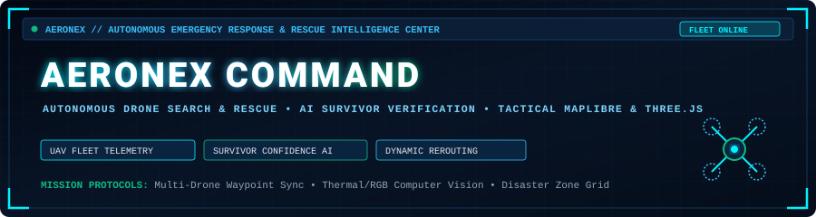
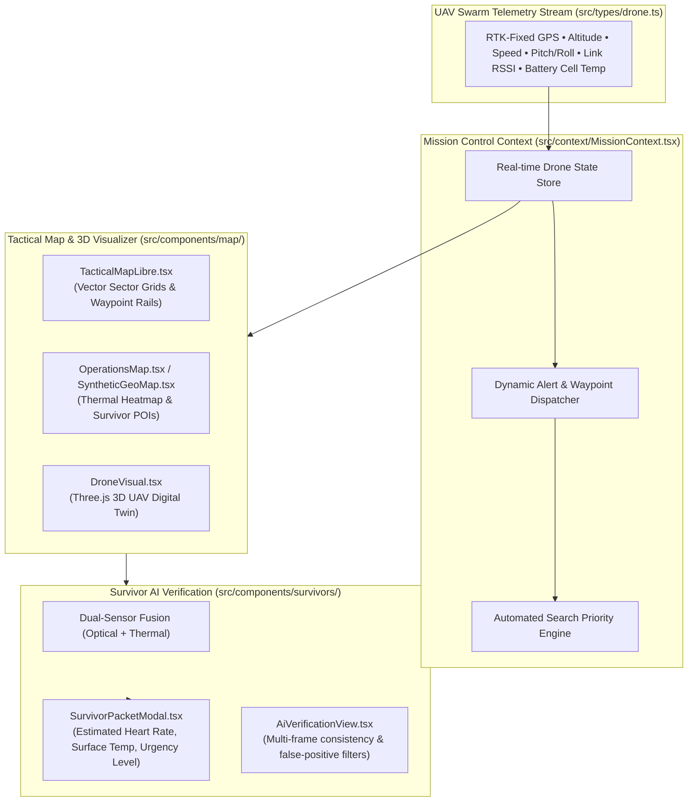

<div align="center">



<br/>

[](https://vitejs.dev)
[](https://www.typescriptlang.org/)
[](https://react.dev)
[](https://threejs.org/)
[](https://maplibre.org/)
[](https://tailwindcss.com/)

</div>

---

## 🚁 1. Mission Context & Problem Statement

In the aftermath of catastrophic natural disasters (floods, landslides, structural collapses, and alpine blizzards), the **"Golden 72 Hours"** determines the survival boundary for trapped human victims. Ground search and rescue (SAR) teams face impassable roads, toxic gas pockets, darkness, and disrupted cellular communications.

While unmanned aerial vehicles (UAVs / drones) can survey vast geographic sectors rapidly, typical operational field deployments suffer from:
1. **Operator Cognitive Overload**: Managing multiple independent drone feeds simultaneously overwhelms field command teams.
2. **High False-Positive Detection**: Single-band optical cameras confuse thermal blankets, animal heat signatures, or reflective debris with human survivors.
3. **Disconnected Dispatch Workflows**: Video feeds are disconnected from real-time tactical maps, delaying field rescue dispatch.

**AERONEX** is an **Autonomous Emergency Response and Rescue Intelligence Command Center**. It aggregates autonomous UAV swarm telemetry, cross-verifies survivors using fused dual-sensor (RGB optical + Long-Wave Infrared Thermal) confidence scoring, and coordinates dynamic mission waypoints across an interactive tactical spatial map.

---

## 🛰️ 2. System Architecture



---

## 🔬 3. Core Capabilities & Telemetry HUD

### 1. Multi-UAV Swarm Telemetry
Tracks real-time flight vectors including **ground speed ($m/s$), barometric altitude ($m$), heading, roll/pitch attitude, RTK GPS fix quality (`RTK_FIXED`, `RTK_FLOAT`, `3D_FIX`), and dynamic link RSSI**.

### 2. Dual-Sensor Survivor Verification (`AiVerificationDetails`)
Eliminates false alarms by fusing:
* **Raw Optical Confidence** (Shape morphology, posture recognition)
* **Thermal Infrared Confidence** (Target heat differential $34^\circ\text{C} - 38^\circ\text{C}$)
* **Fused Multi-Frame Temporal Consistency** (Persistent tracking across consecutive frames)

```
┌────────────────────────────────────────────────────────────────────────────────────────┐
│ SURVIVOR DETECTION PACKET (SAMPLE HUD METRICS)                                         │
├───────────────────────────────┬───────────────────────────────┬────────────────────────┤
│ Target ID: SURV-ALPHA-04      │ Fused Confidence: 94.6%       │ Status: VERIFIED       │
│ Surface Temp: 36.8°C          │ Multi-Frame Tracking: 48 f    │ Priority: CRITICAL     │
│ Optical Match: 92.1%          │ Thermal Match: 97.2%          │ Dispatch: EN ROUTE     │
└───────────────────────────────┴───────────────────────────────┴────────────────────────┘
```

### 3. Hardware Showcase
AERONEX is engineered for rugged outdoor tactical operations with deployable hardware platforms:

<div align="center">
  
  <p><i>Field-deployable autonomous quadcopter airframe equipped with optical zoom and thermal sensor payloads.</i></p>
</div>

---

## 🛠️ 4. Technology Stack

* **Core Framework**: React 18.2 with TypeScript 5.2.
* **Build System**: Vite 5.4.
* **Spatial Mapping**: MapLibre GL, Leaflet, Canvas overlays.
* **3D Visualization**: Three.js (dynamic UAV digital twin and attitude indicator).
* **Styling**: Tailwind CSS with custom cyberpunk terminal theme and neon accents.
* **Icons**: Lucide React.

---

## 🚀 5. Installation & Local Execution

### Prerequisites
* Node.js 18.x or 20.x
* npm or yarn

### 1. Clone & Install
```bash
git clone https://github.com/RatanPandey-007/Aeronex.git
cd Aeronex

npm install
```

### 2. Start the Mission Command Center
```bash
npm run dev
```
Open **`http://localhost:5173`** in your browser to enter the live command center.

### 3. Production Build
```bash
npm run build
npm run preview
```

---

## ⚠️ 6. Operational Considerations

> [!NOTE]
> * **RTK GPS Dependency**: High-precision localization relies on RTK differential base station corrections. In GPS-denied environments, fallback visual-inertial odometry (VIO) waypoints are projected.
> * **RF Spectrum**: Command link frequencies operate over 2.4 GHz / 5.8 GHz frequency hopping channels with automatic Return-To-Home (RTH) failsafes upon connection timeout.

---

## 🗺️ 7. Roadmap

- [x] Swarm telemetry orchestration dashboard with live multi-drone tracking.
- [x] AI survivor verification module with dual-sensor confidence fusion.
- [x] MapLibre GL tactical sector mapping and synthetic coordinates.
- [x] Three.js real-time 3D UAV digital twin rendering.
- [ ] Direct MAVLink / PX4 Autopilot serial telemetry bridge via WebSockets.
- [ ] Automated drone charging station / battery hot-swap logistics scheduling.

---

## 🏷️ Repository Topics
`drone-telemetry` • `search-and-rescue` • `command-center` • `react` • `typescript` • `vite` • `threejs` • `maplibre-gl` • `uav` • `disaster-response`
